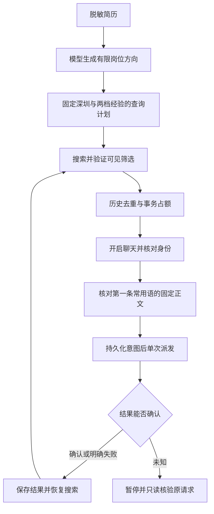

# 简历驱动岗位搜索：使用与学习

本入口使用模型决定岗位方向，用 LangGraph 编排搜索与沟通。城市固定深圳，每个关键词分别搜索 1–3 年、3–5 年。用户当前选择 Edge，正文直接使用现有常用语第一条，不生成新的问候语。实站验收状态见 [验收记录](search-greeting-acceptance.md)。

## 当前方式：人工设置经验（0.6.0）

在BOSS职位页手动同时选中“1–3年”和“3–5年”，再连接扩展。程序保留经验菜单的选择，不再展开、点击或自动修复它；如果两档没有同时选中，会暂停并报告 `MANUAL_EXPERIENCE_REQUIRED`。即使页面另选了5–10年等档位，候选列表仍只返回原定两档的岗位。每次打开岗位和开启沟通前再次核对经验，防止列表更新后误联系。

关键词仍来自模型生成的有限计划。LangGraph依次处理每个关键词的两档候选，经验档位在这里表示对列表的筛选范围，不再表示要点击哪个菜单选项。这是一种人工接管工具操作的方式；没有使用LangGraph的 `interrupt()` API，不应在简历里写成已实现该API。

已从用户指定的已有会话读取第一条保存的常用语，模板ID为 `275d3581-50fb-4bc8-a6d2-f03a01c961ff`。发送前会核对其固定正文hash，改动常用语会暂停。历史未知岗位已由用户授权跳过，原未知证据和去重记录保留。首次实际验收最多1次联系；读取模板成功不代表发送成功。

下面0.5.x浏览器指针章节保留为实现历史；当前v3入口会拒绝旧页面脚本提出的自动指针请求。

## 运行步骤

先构建 `boss.cmd build` 和 `boss.cmd extension:build`。当前源码版本为0.6.0，没有新增权限。更新文件后在 `edge://extensions` 重载扩展并重新连接，加载新的后台与页面适配器。网页已登录与扩展已连接是两个独立条件。

扩展固定加载目录为 `D:\code\jobpilot-edge`，版本副本保存在项目 `dist/boss-extension-<版本>`。旧版完整备份位于 `output/jobpilot/extension-releases/rollback-0.4.3-20261102`；文件版本不等于浏览器实际运行版本，应以连接后适配器读数为准。

## 浏览器级经验选择（0.5.0，实站待验收）

方案A的合成鼠标进入事件未能展开真实菜单。0.5.0在固定搜索动作内使用浏览器调试接口移动指针，读取可见选项位置后点击，再验证选中状态与列表。坐标实时来自已绑定文档，使用页面视口CSS像素，不固定桌面坐标。纯CSS悬停的本地浏览器fixture已通过，不能据此宣布BOSS实站通过。

`debugger`是较宽的浏览器权限，不能设为可选权限，也不能宣称浏览器将其限制为仅BOSS。项目代码限定当前绑定的BOSS职位页及经验控件，不提供任意调试命令、脚本、坐标或其他标签操作入口。浏览器可能显示调试提示；出现其他调试器占用时暂停，不争抢。验收期间不要同时用另一套浏览器控制器操作该标签。

发布前先检查构建和审查结果，再由用户加载更新并接受浏览器权限提示；不要无提示地把新增权限激活到当前已加载扩展。回退时恢复原扩展目录备份并重载；已授予权限若仍存在，应通过扩展管理检查并移除更新版本。

错误区分：`DEBUGGER_PERMISSION_REQUIRED`表示缺权限，`DEBUGGER_ATTACH_FAILED`表示附加被拒绝或冲突，`EXPERIENCE_MENU_NOT_OPEN`表示悬停后仍未展开，`EXPERIENCE_TARGET_COVERED/MOVED`表示目标遮挡/位置不稳定，`EXPERIENCE_SELECTION_UNCHANGED`表示点击后未看到选择变化。它们都不会进入打招呼或无限重试。挂起的观察和调试调用有超时；取消、失败、完成时清理自身调试连接。

学习重点：LangGraph节点仍然是“搜索并验证条件”，具体鼠标交互封装在工具实现中。持久化checkpoint保存业务进度；网页文档、坐标和调试连接属于临时状态，刷新后必须重新观察和获取。

实站控件可以只显示“工作经验 + 已选数量”，具体选中值在菜单选项的状态中。0.5.2根据实际观察到的 `li.active`、容器 `is-select` 和 `select-num` 数量共同判断；仅显示数量不能证明选中了哪一档。操作执行器和最终筛选验证共用这套读取逻辑，避免“已经选中但工作流仍判断失败”。这属于工具的结果验证，LangGraph负责在验证成功后前进、失败时保存状态并暂停。

0.5.1增加操作前激活已绑定标签和窗口、等待目标选项可见，以及固定鼠标阶段记录。下拉容器可见不代表其中的选项可点击。后台窗口是否造成此前输入超时仍是待实测验证的假设。无法激活窗口时返回 `EXPERIENCE_FOREGROUND_UNAVAILABLE`，不会继续点击；超时后到达的回调不能再激活窗口。

## 自动恢复（0.4.1）

首次连接后，同一个已授权标签在刷新时会自动等待页面可读、重新注入固定适配器并绑定新文档，最多尝试3次。旧租约先停止，旧回调不能覆盖新页面。主动“停止并断开”、关标签或离开允许的 BOSS 页面会撤销授权；登录和验证码仍需本人处理。

正在运行的 `search preview/run/resume` 进程会对明确的连接故障自动恢复，整批最多3次，恢复次数和等待时间记入 SQLite。查询位置、固定话术、已联系岗位和剩余额度都沿用原批次。未知发送不自动重发，身份、筛选、话术或额度错误也不会盲目重试。

这不是后台常驻服务：CLI 已退出时不会自动启动新的任务，仍需 `search resume --batch <batchId>`。扩展/浏览器/本地原生宿主重启后需要重新手动连接；恢复不会跨浏览器会话接管其他标签。原批次检测到授权 session/tab 改变时暂停，不静默迁移目标。

学习重点：扩展负责“连接能不能使用”，LangGraph 与业务账本负责“下一步能不能执行”。自动重连成功不代表上一条消息发送失败，也不能重置批次预算。

实站已验证两次同标签刷新后自动重绑，分别约 0.815 秒、0.769 秒，用户未再次点击连接。第二次读取到 boss-dom-0.4.3；这证明连接恢复，不代表两档筛选或打招呼已验收。当前经验菜单尚未被脚本成功展开，详见验收记录。

以下命令在项目根目录运行，用实际输出替换占位 ID。正文从已有聊天的常用语菜单读取；需要当前页面是聊天页，不会为读取话术先联系一个新人。

```powershell
.\scripts\boss.cmd jobpilot search plan --resume 'private/我的简历.txt'
.\scripts\boss.cmd jobpilot search template-first
.\scripts\boss.cmd jobpilot search preview --plan <planId>
.\scripts\boss.cmd jobpilot search run --plan <planId> --template <templateId> --max-contacts 1
.\scripts\boss.cmd jobpilot search status --batch <batchId>
.\scripts\boss.cmd jobpilot search export --batch <batchId>
.\scripts\boss.cmd jobpilot search resume --batch <batchId>
```

默认整批最多 10 次开启聊天尝试，覆盖所有关键词及两档经验；恢复不会重新获得 10 次额度。首次真实验收用 1 次，之后小批次运行。历史额度停止不会因日期变化自动清除，只有核验当前页面并显式使用 `--retry-historical-quota` 才能进入现有策略的重试分支。

`preview` 只检查每个查询的首屏筛选与岗位，不开启聊天。`template-first` 冻结实际读取的第一条正文，发送前再次逐字核对 hash；修改常用语后原批次会暂停。平台默认话术不能替代绑定内容。回复不确定时暂停，不能把超时当作没发出后再次点击。

历史未知发送仍阻止 `run`；零联系的 `preview` 可以检查搜索页面，不修改历史记录。此例外仅针对未确认的联系记录，额度、登录等其他停止条件仍然有效。

## 五个阶段对应知识

1. **结构化输出与证据**：模型只输出角色 ID、简历证据 ID 和理由。程序补全城市、经验和关键词。Schema 检查格式，证据 ID 检查来源是否存在，二者都不能证明模型的语义判断完全正确。
2. **工具协议与观察**：MCP 是程序调用工具的边界。TypeScript、Python 桥和浏览器扩展共同校验 v3 scope。设置筛选后必须读取可见状态；URL 正确不足以证明列表正确。
3. **事务与幂等**：业务 SQLite 同时保存历史判重、占额和动作意图。唯一键阻止同一个岗位跨查询重复沟通。动作派发前持久化完整请求，响应丢失后查原请求，不换 ID 重发。
4. **LangGraph 状态图与恢复**：State 保存查询位置、已见岗位和状态；Node 完成一项工作；条件边决定继续、切换查询或暂停。thread_id 对应批次，checkpoint 保存图的进度；业务账本负责外部动作证据。checkpoint 本身不保证网站消息恰好发送一次。
5. **评估与审查**：合成简历覆盖正常经历、仅使用 AI 工具和提示注入；分别记录格式检查、角色期望和人工语义审查。真实网页验证、模拟回归和真实模型验证是不同证据。

这是一个“模型规划 + 确定性工具工作流”的 Agent 应用。普通 AI 应用可以只完成一次问答；这里还会维护状态、调用外部工具并根据结果决定下一步。无需为了称作 Agent 在每个岗位都再调一次模型。



例如选择常用语后网络断开，LangGraph 可以恢复批次状态，但网站可能已经收到消息。此时由动作账本保留原 requestId，查原结果，禁止把新的调用当作“重试”再次发送。这是面试时最值得讲清楚的恢复边界。

## 面试自测

- 为什么模型不能直接决定城市、预算和任意浏览器操作？
- 为什么选择常用语也可能已经发送，不能在超时后自动补点发送？
- checkpoint 与业务账本各解决什么问题？
- 同岗位出现在两个经验档时怎样避免重复联系？
- 模型引用了真实证据 ID，为什么仍然需要语义评估？

## 简历写法

可描述为：使用 TypeScript、LangGraph、MCP 与 SQLite 实现简历驱动的求职工作流，包含结构化岗位规划、受限工具协议、历史去重、批次预算、持久化检查点与动作账本，编写自动化回归验证恢复与副作用边界。

当前不要写“实站自动投递已稳定运行”或虚构成功率。项目实现语言是 TypeScript；Java 全栈是你的求职方向，不应把尚未实现的 Java 服务写进项目。此流程打招呼，不上传附件简历。
