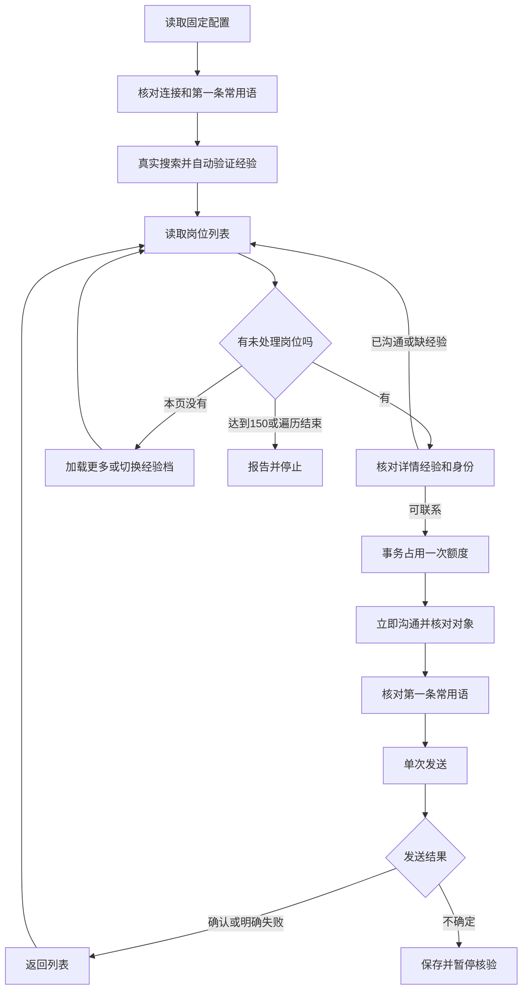

# 固定岗位实战：边运行边学习 Python LangGraph

本入口固定搜索 **Java全栈开发工程师 / 页面当前城市 / 1–3 年、3–5 年**，使用 BOSS 已有常用语第一条，最多占用 **150 次新沟通尝试**。不读取简历，不调用模型，不需要 API Key。

## 当前交付和真实验收状态

最新真实验收：0.7.1重载后，批次 `0d9f852b-3540-4640-9886-fd672aa4b630` 的两档搜索与岗位读取已通过，状态 `completed / PREVIEW_COMPLETE`，城市证据 `city-code:101280100`。未开启新沟通、未发送消息；真实发送闭环仍未验收。

2026-11-09：0.7.1 新批次支持页面当前任意城市，城市规则已贯通 Python、MCP 和浏览器扩展。Python 92 项、桥25项、JavaScript317项测试通过。旧版扩展已备份，0.7.1已更新至原加载目录；真实完整预览需重新加载扩展后验证。下文较早的失败记录用于排查历史，不代表新版已验证失败或成功。

已实现 Python 状态图、真实网页工具接入、自动经验选择、循环/翻页、历史去重、150 次预算、SQLite checkpoint、原请求去重和恢复核验。浏览器适配器版本为 0.7.1。

本地自动化测试与编译不等于 BOSS 实站验收。2026-11-04 的真实零发送预览停在 `BOSS_NOT_CONNECTED`，批次 `7765fa38-8f03-48f2-89ef-de2a25d908c8`，尝试数为 0。随后电脑控制工具无法可靠识别浏览器网址，停止了本轮网页操作，没有改用其他网页控制器绕过限制，也没有发送新招呼。

因此：**代码与本地验证已交付，真实自动筛选、发送、返回列表的完整闭环仍待连接扩展后验收。** 最新测试结果记录在 [实施日志](D:/code/job-search-skills/.superpowers/sdd/2026-11-04-python-fixed-role-greeting/progress.md)。

## 1. 怎样启动

项目在 Windows 本地的 `.venv-jobpilot` Python 环境运行，不需要 Docker。PyCharm 打开 `D:\code\job-search-skills`，选择已有解释器：

```text
D:\code\job-search-skills\.venv-jobpilot\Scripts\python.exe
```

Edge 中重新加载已安装的 JobPilot 扩展，确认版本 0.7.1，再在登录后的 BOSS 页面连接。**打开 BOSS 网站与连接扩展是两件不同的事。** 当前固定加载目录为 `D:\code\jobpilot-edge`，源码构建目录为 `D:\code\job-search-skills\dist\boss-extension`；需加载同一次构建，运行中的旧扩展不会自动采用磁盘新文件。

城市现在跟随 BOSS 页面，新批次不再限制深圳，也不自动切换城市。搜索提交后如果 BOSS 沿用其他城市，程序会记录实际城市证据并继续；报告的 `observed_cities` 可核对。网址有明确城市代码时，优先记录 `city-code:101280100` 这样的原始证据，避免过期页面文字误报；这不是已识别的中文城市名。没有城市代码时才使用明确的页面城市文字。历史批次恢复仍使用创建时的配置，新建 `preview` 才使用新规则。

先执行零发送搜索：

```powershell
Set-Location D:\code\job-search-skills
.\scripts\jobpilot.cmd fixed-search preview
```

预览读取两档真实岗位，只验证搜索和筛选，不点击立即沟通。

首次沟通验收：先在 BOSS 打开一个**已有聊天**，让程序只读取得第一条常用语，再执行：

```powershell
.\scripts\jobpilot.cmd fixed-search run --max-contacts 150 --stop-after 1 --confirm-send
```

这会创建总预算 150 的批次，处理第一个新岗位后暂停，输出批次 ID。核实首个闭环后继续**同一个批次**：

```powershell
.\scripts\jobpilot.cmd fixed-search resume --batch <实际批次ID> --confirm-send
.\scripts\jobpilot.cmd fixed-search status --batch <实际批次ID>
```

`<实际批次ID>` 要替换为终端输出，尖括号不是命令的一部分。首个岗位也计入 150，不会变成 151。

以后已完成实站验收时，可以直接创建完整批次：

```powershell
.\scripts\jobpilot.cmd fixed-search run --max-contacts 150 --confirm-send
```

不要同时运行两个批次。Ctrl+C 可停止；下一次用 resume 核验后继续。不要通过重新创建批次、删除数据库绕过未知结果或当天额度停止。

## 2. 业务流程是什么



1–3/3–5 年取并集。多选控件同时且仅选中两档；有明确单选证据的控件分别搜索两档。每次读取结果、打开岗位和沟通前再次核对，避免网页更新后点错。

搜索词是输入“Java全栈开发工程师”，并不要求所有返回标题完全相同。详情经验缺失或不符合时跳过；不自动放宽地点、经验、话术或预算。

## 3. 先读状态 State

打开 [state.py](D:/code/job-search-skills/python/jobpilot/fixed_search/state.py)。`FixedSearchState` 是流程共享的进度表，例如：

```python
class FixedSearchState(TypedDict, total=False):
    batch_id: str                 # 这一次批次的编号
    mode: str                     # preview 或 run
    band_index: int               # 当前经验档下标
    candidates: list[dict]        # 当前候选
    current_job: dict | None      # 正在处理谁
    attempt_id: str | None        # 这次沟通的记录编号
    seen_job_keys: list[str]      # 本批已经看过的岗位
    status: str                   # running / paused / completed
    stop_reason: str              # 为什么结束或暂停
```

`TypedDict` 帮助你读代码、让编辑器检查类型；它不会自动验证网页数据。参数、岗位身份、经验和工具结果仍需要运行时判断。

统计数字从数据库账本读取，不以 State 中一个随手累加的变量作为最终额度。这样程序重启后不会忘记之前已经联系了谁。

## 4. 节点 Node 就是业务函数

打开 [nodes.py](D:/code/job-search-skills/python/jobpilot/fixed_search/nodes.py)。这些函数在 `make_nodes()` 内创建，共享注入的 `tools`、`store`。

实际的搜索节点：

```python
@safe
def search_and_filter(state):
    return {
        "view": tools.search(BANDS[state["band_index"]]),
        "advancing": False,
    }
```

它读取当前经验档，调用真实网页工具，把结果放回 `view`。返回的字典是 State 的局部更新，不需要返回完整 State。

`@safe` 是普通 Python 装饰器：捕获错误、记录待核验动作、写入停止原因。它不是模型，也不是 LangGraph 提供的魔法函数。

主要节点与业务对应：

| 节点 | 做什么 | 主要状态更新 |
| --- | --- | --- |
| load_config | 核对本批固定配置 | status |
| preflight | 检查连接、额度记录、已有聊天话术 | current_job / attempt_id / route |
| search_and_filter | 搜索并核实经验选项 | view |
| collect_candidates | 从页面整理未处理候选 | candidates / exhausted |
| select_candidate | 去重、检查预算、选下一岗 | current_job / seen_job_keys / route |
| inspect_job | 核对公司、招聘者、详情经验 | current_job / route |
| reserve_contact | 在数据库中占用一次额度 | attempt_id |
| open_chat | 点击立即沟通、核对对象 | chat / route |
| verify_phrase | 核对第一条常用语内容 | 不需要新增业务字段 |
| send_phrase | 单次选择，必要时单次提交 | 外部动作证据写账本 |
| inspect_result | 读取消息送达/失败证据 | 确认结果写账本 |
| restore_search | 返回列表并重新观察 | view，清空当前对象 |
| advance_results / next_band | 加载更多或切换经验档 | advances / band_index |
| summarize | 保存结果 | report |

## 5. 普通边、条件边和循环

打开 [graph.py](D:/code/job-search-skills/python/jobpilot/fixed_search/graph.py)。

```python
graph = StateGraph(FixedSearchState)
for name, fn in make_nodes(tools, store).items():
    graph.add_node(name, fn)
graph.add_edge(START, "load_config")
graph.add_edge("summarize", END)
```

`add_node` 注册函数；`add_edge` 指定固定的下一步。START / END 表示图的开始和结束。

有错误出口的节点使用条件边。实际代码中的 `next_step()` 返回路由函数，判断：

```python
if state.get("status") != "running":
    return "summarize"
return default or state["route"]
```

成功路径可以固定去下一步，出错时统一去报告。例如发送后通常去 `inspect_result`；异常时去 `summarize`，报告状态为 paused，而不是伪装成功。

循环也靠边实现：`restore_search → collect_candidates → select_candidate → …`。业务函数检查额度和列表结束，决定是否退出；LangGraph 的 `recursion_limit=8000` 只是额外防止异常循环，不是“8000 次招呼”。

`compile(checkpointer=...)` 把图构造成可运行对象；CLI 用 `graph.stream(..., stream_mode="updates")` 获得每个节点的更新并打印进度。

## 6. 浏览器工具做什么

打开 [tools.py](D:/code/job-search-skills/python/jobpilot/fixed_search/tools.py) 和 [bridge.py](D:/code/job-search-skills/python/jobpilot/bridge.py)。

调用链为：

```text
Python 节点
  → FixedTools（业务验证）
  → BossBridge（本机 MCP 请求）
  → 浏览器扩展（点击、读取、等待结果）
  → 真实 BOSS 页面
```

LangGraph 本身不认识“立即沟通”按钮。扩展在真实页面识别控件、执行动作并返回证据；Python 决定下一步。

主要浏览器实现：

- [search-actions.js](D:/code/job-search-skills/extensions/boss-page/search-actions.js)：搜索、返回列表、详情读取。
- [experience-pointer.js](D:/code/job-search-skills/extensions/boss-page/experience-pointer.js)：限定经验控件的指针操作。
- [chat-actions.js](D:/code/job-search-skills/extensions/boss-page/chat-actions.js)：聊天身份、常用语、消息结果。

自动选择经验必须观察到真实选中标记。触发点击、改变 URL、程序没有报错，都不足以证明筛选成功。

## 7. 150 次怎样做到不超额

打开 [store.py](D:/code/job-search-skills/python/jobpilot/fixed_search/store.py) 的 `reserve()`。

```text
BEGIN IMMEDIATE
  → 检查历史和未解决动作
  → 检查是否已经占过本岗位额度
  → 比较已占用次数与本批上限
  → 插入 opening 记录
COMMIT
```

只有占位成功才能点击立即沟通。第 151 次占位会收到 `CONTACT_LIMIT`。

| 情况 | 是否占用次数 |
| --- | --- |
| 开启沟通前发现已联系、详情缺经验或失效 | 不占用 |
| 已占位，随后点击失败或进程崩溃 | 占用一次，不返还 |
| 消息结果未知 | 占用一次，并暂停 |
| 恢复同一个岗位的原尝试 | 不额外占用 |

所以“已占用尝试 150”不等于“确认发送 150”，报告分别列出。

## 8. checkpoint 与账本为何都需要

`data/jobpilot-fixed-checkpoints.sqlite` 保存图状态，`thread_id` 使用批次 ID。`data/boss.sqlite` 保存原有历史和新增批次/动作。

示例：已经点击常用语，网络断了。

- checkpoint 告诉你程序执行到了哪一步。
- 动作账本保留 `attempt_id`、逻辑动作键和原 `requestId`。
- 恢复时查询原请求，已知发送动作不再点击一次。
- 选择前的消息数量和摘要作为 receipt 保存；新租约丢失网页内存状态后，用摘要检查消息前缀，再核实是否新增了那条常用语。
- “发送中”是临时结果，可以追加新的只读观察；已经明确送达/失败的结果保持不变。

恢复依然有条件：页面必须能证明当前会话对应的真实岗位 ID；消息历史必须能通过原摘要检查；浏览器会话和授权目标不能静默变化。任一证据缺失就暂停，不能保证所有断线都自动恢复，也不能仅凭 checkpoint 承诺网站消息恰好发送一次。

## 9. 错误与结果在哪里

结果文件在 `output/jobpilot/fixed-search/<批次ID>.json`。包含逐岗尝试、状态、证据与停止原因，不包含模型密钥。

| 错误/原因 | 含义 |
| --- | --- |
| BOSS_NOT_CONNECTED | 网页可能已打开，但扩展桥没有连接 |
| EXTENSION_UPDATE_REQUIRED / BRIDGE_CONTRACT_MISMATCH | 运行中的版本和本地代码不同 |
| TEMPLATE_READ_REQUIRES_EXISTING_CHAT | 首次 run 需从已有聊天读取话术 |
| JOB_EXPERIENCE_UNVERIFIED | 详情经验缺失或不符合，跳过 |
| CHAT_JOB_KEY_UNVERIFIED | 恢复时无法证明实际岗位 ID，暂停 |
| FIRST_PHRASE_CHANGED | 常用语与本批冻结内容不一致 |
| SEND_HISTORY_CHANGED | 原消息基线无法核验 |
| ACTION_UNKNOWN / SEND_UNKNOWN | 结果无法确认，不重发 |
| CONTACT_LIMIT | 达到本批上限 |
| VALIDATION_PAUSE | `--stop-after` 指定的单岗验收暂停 |

原来的 `learn`、`learn-graph`、`learn-model`、`analyze` 都保留。现在学习这条固定流程时，优先按 **state.py → graph.py → nodes.py → tools.py → store.py → cli.py** 阅读。
# 连接后出现 INVALID_SCOPE / ACTION_UNKNOWN

如果 `load_config` 完成、`preflight` 暂停，先区分“扩展已连接”和“扩展接受任务参数”。连接成功不代表后者成功。

2026-11-09 排查记录：批次 `af5037f2-ff78-4a43-bb8a-dca605a8a8f7` 的页面读取成功，但 `start_run` 被扩展以 `INVALID_SCOPE` 拒绝。Python 账本与桥端请求指纹一致，排除了这两个边界间的参数改变；同一参数可通过当前磁盘代码校验。Edge 配置指向 `D:\code\jobpilot-edge`，其中 12 个文件与构建产物一致。尚未验证浏览器内存中的后台版本，不能把旧版本缓存作为已确认根因。

Python 已修正错误展示：明确拒绝的 `INVALID_SCOPE` 不再合并成 `ACTION_UNKNOWN`，也不会重新派发。下一步在 `edge://extensions` 重新加载扩展，返回 BOSS 职位页连接，然后执行 `scripts\jobpilot.cmd fixed-search preview`。这里只做预览，不发送招呼。

同日后续实测：用户重新加载并连接后，批次 `f56dc8c1-1f3c-48a0-9b63-e3d81c0a89f1` 的 `inspect_session`、`start_run`、`renew_run` 均成功，原 `INVALID_SCOPE` 不再出现。搜索阶段返回 `CITY_MISMATCH`；浏览器清单确认绑定标签当前为“广州招聘”，URL 的城市参数为 `101280100`，不符合固定深圳条件。终端现已保留这个明确错误并提示切换深圳。90 项 Python 测试和 10 项相关扩展测试通过；完整真实预览仍未通过，未发送招呼。

