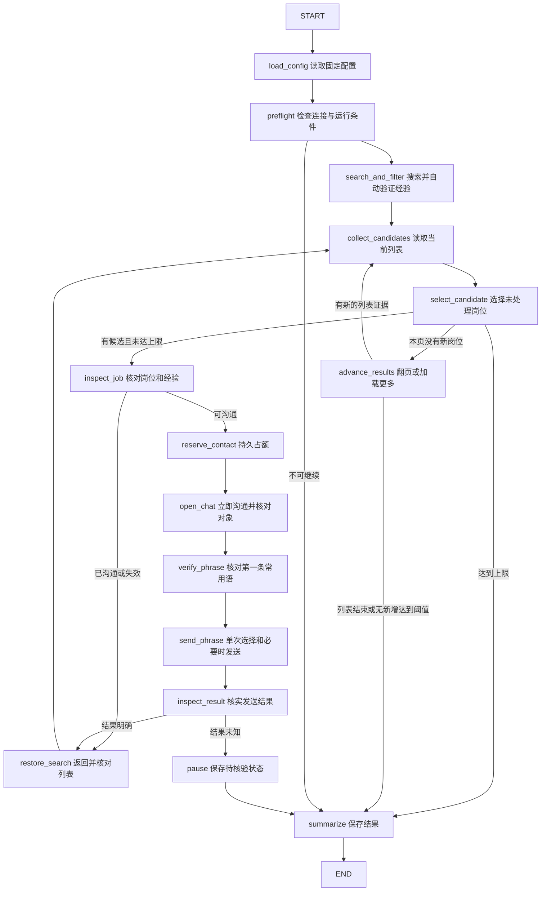

# Python LangGraph 固定岗位批量沟通设计

状态：用户已选择方案 A，并以“开始编译代码”确认实施；本地代码、测试与构建已交付，真实网页验收受连接和电脑控制工具阻塞。具体结果见实施日志及 docs/python-fixed-search.md。本文不是真实发送成功的证明。

## 1. 目标和已确认要求

用户是 Python / LangGraph 初学者，希望边实现真实业务，边理解代码。

- 固定搜索词：Java全栈开发工程师。
- 进入 BOSS 直聘，选择工作经验 1–3 年、3–5 年。
- 顺序打开符合条件且未沟通过的岗位，点击立即沟通，使用常用语第一条，返回搜索列表，继续下一岗。
- 每批最多 150 次新沟通尝试，到达上限停止；提前出现平台额度限制时停止。
- 用户选择方案 A：Python LangGraph 编排，复用现有 Edge 扩展与 MCP 桥。
- 用户的新要求允许这个固定范围的自动打招呼，不扩大为回复消息、发送附件、交换联系方式或处理其他岗位方向。

沿用现有工作区城市“深圳”。“退出来”解释为返回岗位列表，不是退出登录或关闭浏览器。这两项是设计沿用/解释，用户可更正。

本入口不读取简历、不调用模型，不要求模型 API Key。原有简历分析及第一至第三周学习入口保留。

## 2. Approaches：已讨论的实现路线

| 路线 | 收益 | 代价 | 选择 |
| --- | --- | --- | --- |
| A：Python 状态图 + 现有浏览器工具 | 节点和业务步骤可以直接用 Python 学习，复用既有页面识别与发送核验 | 需要补齐批次计数、循环、恢复和自动筛选 | 用户已选择 |
| B：扩展已有 TypeScript 搜索图 | 已有连续搜索、返回列表与账本机制，可复用更多业务编排 | 学习主线仍在 TypeScript，不符合当前 Python 学习重点 | 未选择 |

不把现有 TypeScript 图包一层 Python 启动器当作方案 A。Python 控制业务流程，TypeScript / 扩展只提供受限的页面动作和证据。

这是涉及 Python、桥协议和浏览器筛选的完整功能，不是把联系次数改成 150 的小修改。

## 3. 当前事实与需要改变的地方

- `python/jobpilot/graph.py`：简历分析 → 搜索 → 选择一个岗位 → 沟通一次 → 报告；没有批量循环。
- `python/jobpilot/tools.py`：现有真实搜索和单岗沟通，包括岗位/招聘者核对、第一条常用语核对、发送与结果检查。
- `python/jobpilot/bridge.py`：调用现有本地 MCP 桥，派发前记录 requestId，异常时查询原动作结果；当前授权 scope 最多 1 次。
- `python/jobpilot/ledger.py`：SQLite 历史去重、事务占位、动作记录；每个 run 最多一条尝试记录，且构造时新建 run；不能直接承担批次恢复。
- `src/jobpilot/search-graph.ts` / `search-nodes.ts`：已有 TypeScript 批量工作流，可参考业务行为，但不直接迁入所有复杂性。
- `contracts/boss-search-v3.schema.json` 和 `src/boss-extension/search-protocol.ts`：搜索 scope 当前上限 100，需协同提升为 150。
- 当前 0.6.0 页面流程要求用户手动选经验。历史自动指针方案有真实页面超时和选项不可见问题，不能把已有代码视作自动筛选已通过。
- 本目录不是 Git 仓库；本次保存设计文件，不初始化仓库、不伪称已提交。

## 4. 对外行为与入口

新增独立的 `fixed-search` 命令族，避免初学者混淆简历分析与固定条件沟通。以下为拟定命令，尚不可执行：

```powershell
.\scripts\jobpilot.cmd fixed-search preview
.\scripts\jobpilot.cmd fixed-search run --max-contacts 150 --confirm-send
.\scripts\jobpilot.cmd fixed-search status --batch <批次ID>
.\scripts\jobpilot.cmd fixed-search resume --batch <批次ID> --confirm-send
```

- `preview`：真实搜索并自动选择/核验两档经验，读取岗位，无新沟通动作；可在不联系新人的已有会话读取常用语。
- `run`：固定关键词、深圳、两档经验；允许 1–150 的整数，默认 150。每次独立新任务产生一个批次 ID。
- `status`：读取本地进度和停止原因，不接管网页、不发送。
- `resume`：使用原批次预算、固定话术和历史动作记录；不新增 150 次额度。
- 无隐式后台循环，无定时任务；结束后停止租约，保留浏览器与登录状态。
- 已有 `manual_only` 通用配置保持原义；新命令的明确发送参数只授权本次固定流程，不全局放开其他入口。

控制台逐节点打印中文说明、当前岗位、尝试数/150、确认发送数、跳过数与停止原因。不输出密钥、完整聊天或简历。

## 5. 节点与流程



图中省略各节点相同的异常出口：登录/验证码、筛选或身份不符、常用语变化、连接无法恢复等均进入 `pause`；额度耗尽立即停止新增联系。它们不是静默跳过的正常岗位。

`preview` 在读取筛选结果后直接汇总，不经过占额和沟通节点。

每个节点是读取状态、调用一个业务步骤、返回局部状态更新的普通 Python 函数。具体鼠标、DOM 和网页等待逻辑留在工具层。

## 6. 状态、边和边界：教学定义

建议以 `TypedDict` 定义 `FixedSearchState`；类型提示不替代入口参数和工具响应校验。

| 状态字段组 | 内容及作用 |
| --- | --- |
| 配置 | batch_id、mode、keyword、city、experience_bands、max_contacts |
| 列表进度 | candidates、current_job、seen_job_keys、页面进度、连续无新增次数 |
| 本次动作 | attempt_id、动作逻辑键、当前步骤、结果状态 |
| 统计 | used_contacts、confirmed_count、failed_count、skipped_count、uncertain_count |
| 控制 | status、stop_reason、error_code |

话术正文保存在受保护的本地模板记录，状态持有模板 ID/hash。浏览器连接、DOM 节点、坐标及令牌不进入 checkpoint；恢复时重新取得有效页面绑定。

- 节点：例如 `inspect_result` 做“检查结果”这件事。
- 普通边：如 `send_phrase → inspect_result`，固定下一步。
- 条件边：例如结果明确返回列表，结果不确定进入暂停；候选为空则加载更多。
- 循环：`restore_search → collect_candidates → select_candidate`，不是 Python 中无限 `while True`。
- START / END：图执行的起点和终点；结束不代表所有目标都成功，需看最终状态。
- 业务边界：关键词、城市、经验、预算、发送对象和话术限制；用配置校验、节点检查及条件边落实，不是另一种 LangGraph “边”。
- checkpoint：记录下一步从哪里继续；业务账本：记录哪些外部动作可能发生过。checkpoint 不能保证网页消息恰好发送一次。

学习文档将按“真实页面步骤 → Python 函数 → 读写哪些状态 → 下一条边 → 验证证据”逐模块讲解，并链接最终代码行号。

## 7. 自动选择经验和搜索范围

默认在真实页面同时选中且只选中 1–3 年、3–5 年，保持用户原要求。已有协议按档返回列表时，工具内部适配两个逻辑档位，合并去重；不让学习者承担两套搜索协议细节。

如果实际控件只支持单选，允许顺序搜索两个档位，最终取并集并去重；日志明确实际采用的方式。是否多选必须来自真实控件观察。

自动经验筛选先复现历史失败，核对当前页面结构、选项状态、前台/菜单就绪和既有指针执行器。复用已有限定经验控件的浏览器指针能力，不写死屏幕坐标、不强改网页选中样式。

自动筛选是本次交付要求。手动勾选只能作为明确标识的临时接管，不能据此宣称自动筛选完成。若自动选择仍被阻塞，交付报告明确列出未通过项。

设置后核对关键词、深圳、经验选中证据以及列表就绪/更新证据。岗位详情经验缺失或不在范围内则跳过并记录原因；身份不确定暂停。搜索词是精确输入文本，不要求每条职位标题与之逐字相等，也不引入额外模型匹配或薪资筛选。

翻页/加载更多由现有页面能力决定，每次重新读取岗位 ID；不缓存列表下标。每个逻辑档最多 50 次加载动作，连续 3 次已确认列表就绪且没有新增岗位则结束该档。网页未就绪/超时算错误，不算“没有岗位”。上述阈值是实现者建议，报告需区分网站明确结束与遍历上限。不要继承旧图“每档 100 个已见岗位”的截断导致 150 次目标不可达。

## 8. 150 次预算与外部动作

预算口径沿用上一轮方案：150 次新沟通尝试上限，不承诺成功发送 150 条，也不是平台官方额度。

1. 已沟通/历史处理过/详情不符合或失效，在占额前跳过，不计预算。
2. 点击立即沟通之前，事务中完成历史去重检查、预算检查和占位；唯一键防止同岗位在两个经验档重复。
3. 占位成功就扣一次。占位后发生失败、崩溃或未知结果也不返还，确保最多 150 次；报告将其称为“已占用沟通尝试”。
4. `confirmed_count` 仅在存在常用语发送确认依据时增加。不能以点击按钮或进入聊天页代替确认。
5. 第 150 次尝试处理完后，只允许必要的只读核验/返回列表/保存，不再打开第 151 个新聊天。
6. 同一批次恢复与进程重启不重置计数；原子账本是计数真值，图状态仅展示它。
7. 页面层与 Python 账本各自执行上限，并核对批次和剩余授权。恢复时页面运行租约更换不得恢复满额。

复用现有跨 Python/TypeScript 运行锁，阻止两个入口并发控制同一页面。保留既有历史去重和未知记录，不清空旧账本。

首次实站单岗核验计入同一个最多 150 次的批次；核验后可继续原批次，避免“先测 1 次再额外发 150 次”。

## 9. 第一条常用语与异常处理

- 优先从已有会话读取当前第一条常用语并冻结正文与 hash，不为读取模板先联系新人。现有模板只有在页面重新核对一致后才可复用。
- 没有可读取的已有会话或无法确认常用语就绪时，报明确原因并暂停，不用平台默认招呼代替。
- 每岗发送前核对会话对应的岗位、公司、招聘者及第一条常用语。正文改变时暂停，不静默换内容。
- 选择常用语可能直接发送，也可能只填入输入框；只有确认是已填入状态才执行一次发送按钮操作。
- 不把“立即沟通”可能触发的平台自带招呼当成常用语已发送；实际发生的阶段分别记录，不额外生成文本。
- 打开聊天、选择常用语、提交发送均视为可能产生外部效果的动作。动作前持久化逻辑动作键、原 requestId 和尝试 ID；崩溃后先查该动作原结果，不生成新 requestId 重放未知发送。
- 当前岗位结果未知时暂停整批并保留证据；不得因退出节点后重新进入而重复点击。
- 可明确证明没有外部效果的读取/搜索连接错误最多恢复 3 次；无法确认动作是否已发生则进入核验分支，不盲重试。
- 登录、验证码、调试器冲突、权限缺失交给用户处理，不切换账号、绕过限制或接管其他标签。

历史额度记录需保留日期和证据。旧日期不自动等同于今天额度耗尽，也不等同于已恢复；显式运行在当前页面预检查后才允许新的有预算尝试。当前额度耗尽提示立即落账停止，当天不因新建批次或 resume 解除。未知旧发送保持阻塞，除非已有明确处理决定。

## 10. 持久化和恢复

增加 Python 批次存储并接入持久化 LangGraph checkpointer；实现者选择与当前依赖兼容的 SQLite saver 并固定依赖版本，不把普通业务 SQLite 表称作 checkpoint。使用 batch_id 作为稳定 thread_id。

执行前核对 checkpoint、批次账本与外部动作记录：

- 确认完成的动作只读取结果，不重新发送。
- 不确定的动作查询原请求与可见页面证据；仍不确定则继续暂停。
- 尚未派发的动作在重新验证配置/对象/预算后继续。
- 同一已授权页面刷新后重新验证文档；更换标签或浏览器会话不能静默迁移授权目标，需要显式重绑定流程。
- `resume` 不更换关键词、经验、模板或最大次数，不能把暂停记录当成新任务。
- 若未知动作无法由平台证据消除，第一版不提供自动判成功、自动跳过未知或自动补发功能。

递归步数需按最多 150 次和有界遍历合理设置；LangGraph 的递归上限是异常保护，不承担业务预算。Ctrl+C 尽量保存状态和释放租约；突然退出后由持久记录核验，不能凭“正常退出钩子”保证安全。

## 11. 代码组织与兼容范围

拟新增 `python/jobpilot/fixed_search/`，按职责拆分：

| 模块 | 职责 |
| --- | --- |
| `state.py` | TypedDict、状态值与固定配置 |
| `graph.py` | 节点注册、普通边、条件边 |
| `nodes.py` | 简短业务函数，供初学者逐个阅读 |
| `tools.py` | 复用 BossBridge，封装自动搜索、详情、聊天、话术及返回 |
| `store.py` | 批次预算、幂等动作、兼容历史去重、恢复核验 |
| `cli.py` | preview/run/status/resume、参数校验、中文进度和报告 |

原 `python/jobpilot/cli.py` 仅增加命令分派；不破坏已有学习入口。复用/抽取现有逻辑，避免复制出相互不一致的历史去重或发送判定。

跨层更新：Python bridge 的批次/预算参数与原请求查询；JSON 契约、TypeScript 校验、扩展运行授权中的 150 次限制；限定经验控件执行器、页面适配器及对应测试。检查所有相关验证器，不能只改 JSON 的 maximum。

扩展构建、桥和 Python 检查同一 schema hash/适配器能力。旧桥或旧扩展必须明确提示更新，不能默默兼容不同上限和筛选语义。保留旧入口手动经验模式，通过明确能力/模式区分本次自动经验流程，避免改变其他命令的既有行为。如何版本化具体契约由实现者决定并记录。

复用现有权限范围；若发现确需新增浏览器权限，先把具体新增项写入修订设计，不悄然扩大。更新构建不等于运行中扩展已更新，实测需读取运行版本。

## 12. 验收与学习交付

按以下顺序执行，报告中区分本地回归、真实网页读取和真实发送证据：

1. 本地测试：第 150 次可占额，第 151 次被拒；参数越界；已沟通跳过；跨档去重；两个进程不能并发；恢复保持计数。
2. 外部动作故障测试：点击后响应丢失、占额后崩溃、发送后 checkpoint 未写入、话术变化、身份变化、确认结果缺失；验证不重复发送。
3. 自动筛选回归：菜单隐藏/延迟/多选/单选、遮挡、刷新、选项变化及真实浏览器交互；这些测试通过不等于 BOSS 实站通过。
4. 真实零发送预览：用户已登录且扩展连接后，自动搜索并选择经验，读取真实候选与明确证据。
5. 同一批次首个真实岗位闭环：核实对象、第一条常用语、发送结果及返回列表；成功后再继续有界批量。首个闭环未通过就停止，不为验收继续消耗招呼。
6. 批量验收：逐岗真实处理，达到 150、平台额度、无新岗位或明确异常时停止。不能用模拟的 150 次成功宣称真实发送了 150 条。
7. 输出中文结果：已占用尝试、确认发送、明确失败、跳过、待核验、停止原因、批次 ID、逐岗证据索引，以及可否恢复。

学习交付包括中文模块说明、最终代码链接、流程图、State 更新示例、普通边/条件边对照、真实运行命令和实际验收结果。阶段一读 State/搜索节点，阶段二读单岗闭环，阶段三读循环/预算/恢复；各阶段保留可独立运行的 preview/status 观察方式。

不包含：自动回复、发送/改写简历、薪资谈判、跨账号运行、定时重复批次、保证平台每天可发送 150 条。

## 13. 设计状态与下一步

本设计已完成独立 builder check（`nothing important left`），随后经用户确认进入计划与实施。当前本地实现及编译测试通过，真实预览停于扩展未连接；本轮没有发送新招呼。待用户重载并连接0.7.0后继续真实筛选及同批单岗验收。
